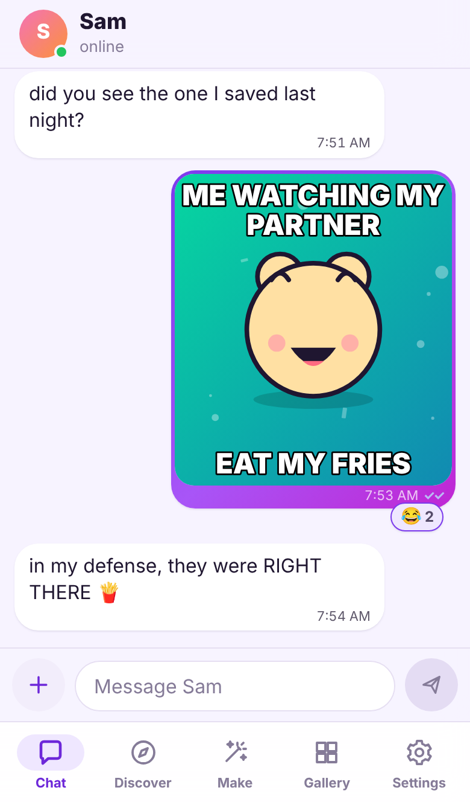
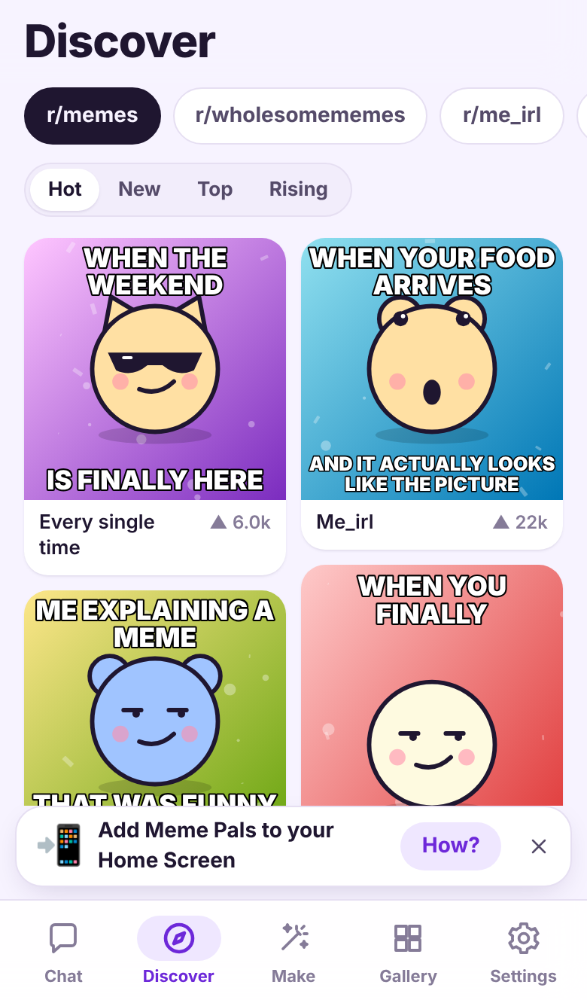
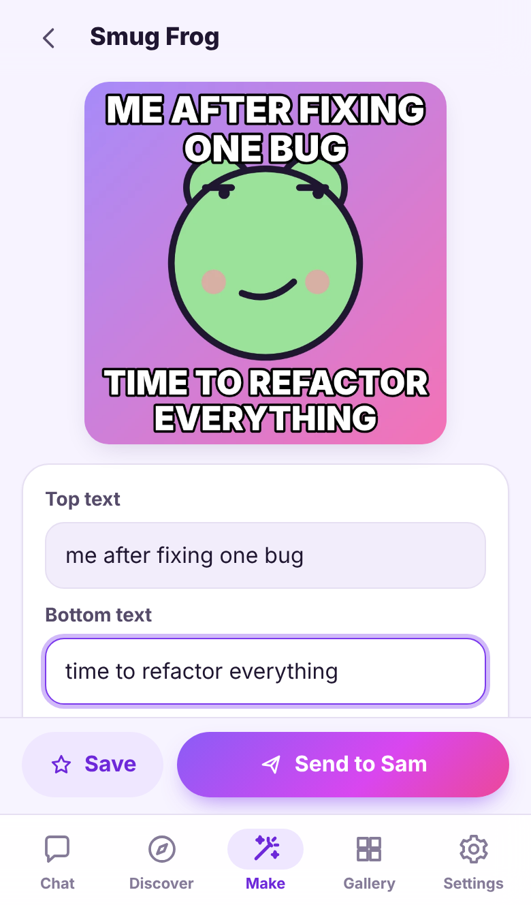
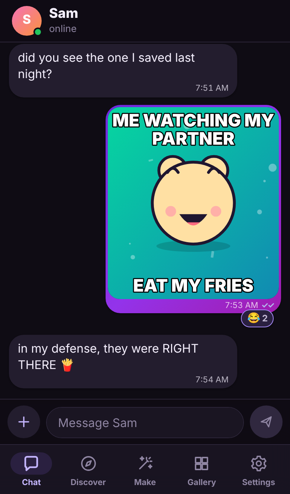

# Meme Pals

A private app for two people to share memes and chat. **Nothing is stored in the cloud.** Every message and meme lives only on your two phones, and they talk to each other directly over an encrypted connection.

<p>
  
  
  
  
</p>

## What it does

- **Chat:** text, replies, reactions, typing indicator, and read receipts (🕓 pending, ✓ delivered, ✓✓ read).
- **Discover:** browse meme subreddits (the list is editable, and NSFW posts are hidden by default). Tap a meme to send it to your partner or save it.
- **Make:** pick an Imgflip template, add captions, and send. Captions are drawn **on your phone**, so your meme is never uploaded to Imgflip.
- **Upload:** send images or GIFs from your phone. Photos are resized and their location and camera data is stripped first.
- **Gallery:** every meme you've exchanged, with favorites and search.
- **Works offline:** messages you send while your partner is away wait on your phone and deliver automatically when you're both online.
- **Installable:** add it to your Home Screen on iPhone or Android, or use it in a desktop browser.

## How privacy works

```
 Your phone ◄════ encrypted WebRTC (device to device) ════► Partner's phone
   │  IndexedDB (all your data)                             IndexedDB  │
   └──────────► Relay: only introduces the two devices ◄────────────────┘
                (stores nothing, can't read anything)
```

| What | Where it goes |
|---|---|
| Messages, memes, names, reactions | Only to your partner's device, over an encrypted WebRTC DataChannel |
| Pairing secret | Never leaves your device, except when you show the QR code or code to your partner |
| Connection setup (WebRTC offers and answers) | Through the relay, signed with a key only your two devices know, so the relay can't intercept or forge them |
| Meme browsing | Your phone fetches Reddit and Imgflip directly. If they block the browser, it goes through the relay's pass-through proxy, which caches and logs nothing |
| STUN (finding a network path) | Public STUN servers see your IP address, as with any video-call app. You can run your own; see [deploy/README.md](deploy/README.md) |

Since your history lives only on your devices, **use Settings → Export backup now and then**. If you lose a phone, a backup file is the only way to recover the messages it sent. See [docs/SECURITY.md](docs/SECURITY.md) for the full threat model.

## Getting started

### 1. Host the relay (once)

Both phones need to reach the same relay over **HTTPS**. Phones only allow WebRTC, the camera and installable apps on secure pages. The relay also serves the app itself. Pick one:

- **A small cloud container** (Fly.io, Render, or a $4 VPS with Caddy). It has no disk volume, so it can't store anything.
- **A computer at home**, exposed through Cloudflare Tunnel or Tailscale Funnel.

Step-by-step instructions for both are in **[deploy/README.md](deploy/README.md)**. The short version, with Docker:

```sh
docker build -t meme-pals .
docker run -p 8787:8787 --read-only meme-pals
```

### 2. Install on both phones

1. Open your relay's `https://` address.
   - **iPhone:** in Safari, tap **Share → Add to Home Screen**.
   - **Android:** in Chrome, tap **⋮ → Install app** (or accept the install banner).
2. Open Meme Pals from the Home Screen and enter your name.

On iPhone, use the Home Screen app rather than a Safari tab. iOS keeps an installed app's storage much more reliably.

### 3. Pair

1. On one phone, tap **Show my code**.
2. On the other, tap **Join my partner**, then **Scan QR code** and point the camera at the first phone's screen. It joins by itself as soon as it reads the code. You can also type the code.
3. Once both screens say you're connected, you're done. You only pair once.

Tips:

- The camera needs the app's `https://` address. Over plain `http://` (for example a LAN IP during development) the phone won't allow it, so type the code or use a photo instead.
- If the camera won't read it, turn up the brightness on the phone that shows the code and hold the phones 15–30 cm apart.
- **Pairing from afar:** tap **Save QR image** on the first phone and send the picture to your partner. They tap **Choose a photo of the code** and pick it (a screenshot works too).

Anyone with the code can pair with you until your partner joins. Share it only with your partner, preferably in person, and delete it from chats afterwards.

## Development

Requires Node 20+ and pnpm 10.

```sh
pnpm install
pnpm dev          # relay on :8787 + Vite on :5173 (proxies /ws, /proxy and /config to the relay)
```

- Open two **separate** browser profiles (or a normal and a private window) at http://localhost:5173 to pair with yourself.
- Open http://localhost:5173/?demo=paired to try the UI with simulated data: no network, and nothing is stored.

```sh
pnpm typecheck    # all packages
pnpm test         # unit, integration, and real-Chromium WebRTC tests
pnpm test:e2e     # two-device end-to-end suite (builds the app first)
pnpm start        # production build served by the relay on :8787
```

### Project layout

```
packages/shared   protocol types, pairing crypto (HKDF/HMAC), ULIDs, validators
apps/relay        stateless signaling relay + pass-through proxies + static server
apps/web
  src/p2p         WebRTC transport: signed signaling, reconnects, chunked image transfer
  src/db, sync    IndexedDB (Dexie) storage and the device-to-device sync engine
  src/memes       Reddit / Imgflip clients, upload processing, on-device meme renderer
  src/ui          screens (React), plus mock services for ?demo
  src/pwa         manifest, service worker, install prompts
  src/services    wires the real services together
deploy/           hosting guides, Fly.io / Caddy / coturn configs
```

[PLAN.md](PLAN.md) has the full design and describes how the work was split across agents.

## Known limitations

- **No notifications while the app is closed.** Push notifications need a cloud push service, which conflicts with the privacy goal. Messages arrive the next time both apps are open.
- **Both phones must be online at the same time** for messages to deliver. Until then they wait in the sender's outbox.
- **A wiped or lost phone** gets your partner's messages back after re-pairing, but not the messages it sent, unless you restore a backup.
- **Strict mobile networks** occasionally block direct connections. If pairing never connects on cellular data, set up the optional TURN server described in [deploy/README.md](deploy/README.md).
- **Reddit** may rate-limit or block anonymous browsing. The app falls back to the relay proxy automatically.
